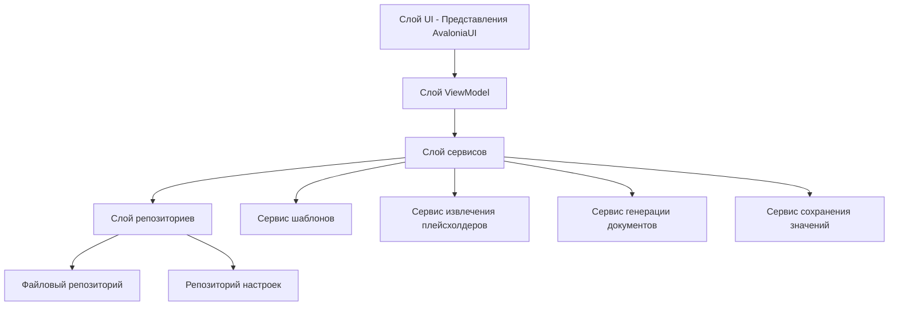
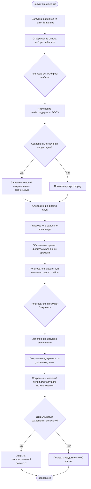
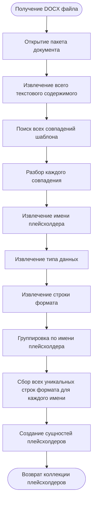
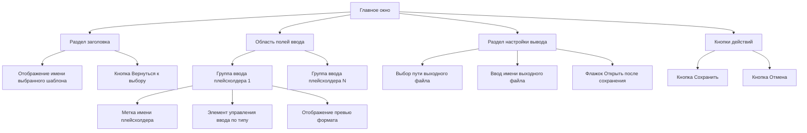

# Проектирование десктопного приложения DocTemplater

## Обзор проекта

DocTemplater — это десктопное приложение, построенное на AvaloniaUI, которое позволяет пользователям заполнять шаблоны документов DOCX структурированными данными. Приложение извлекает плейсхолдеры из файлов шаблонов, генерирует соответствующие формы ввода и создает заполненные документы с предоставленными пользователем значениями.

## Основные требования

### Функциональные требования

- Чтение DOCX файлов из папки Templates
- Предоставление доступных шаблонов для выбора пользователем
- Извлечение плейсхолдеров формата `{НазваниеПлейсхолдера:Тип(СтрокаФормата)}`
- Генерация динамических форм ввода на основе извлеченных плейсхолдеров
- Отображение превью формата для каждого плейсхолдера
- Возможность указания пути и имени выходного файла
- Заполнение шаблона данными пользователя и сохранение по указанному пути
- Опциональное открытие сгенерированного документа после сохранения
- Сохранение заполненных значений для каждого шаблона для будущих сессий

### Поддерживаемые типы данных

- String (строка)
- Integer (целое число)
- DateTimeOffset (дата)

## Архитектура системы

### Слои приложения

Приложение следует паттерну многослойной архитектуры:

- **Слой представления**: Представления AvaloniaUI и модели представлений, реализующие паттерн MVVM
- **Слой бизнес-логики**: Сервисы обработки шаблонов, извлечения плейсхолдеров и генерации документов
- **Слой доступа к данным**: Чтение файлов шаблонов, сохранение значений и запись документов
- **Доменный слой**: Основные сущности и объекты-значения, представляющие шаблоны, плейсхолдеры и пользовательские данные

### Структура компонентов



## Модель данных

### Сущность Template (Шаблон)

| Свойство | Тип | Описание |
|----------|------|-------------|
| TemplateId | Уникальный идентификатор | Внутренний идентификатор шаблона |
| FileName | String | Имя DOCX файла |
| FilePath | String | Полный путь к файлу шаблона |
| Placeholders | Коллекция Placeholder | Извлеченные плейсхолдеры из документа |
| LastModified | DateTimeOffset | Временная метка изменения файла |

### Сущность Placeholder (Плейсхолдер)

| Свойство | Тип | Описание |
|----------|------|-------------|
| Name | String | Уникальное имя плейсхолдера (например, "Дата начала") |
| DataType | Перечисление | String, Integer или DateTimeOffset |
| FormatPatterns | Коллекция String | Все уникальные строки формата, найденные для этого плейсхолдера |
| OccurrenceCount | Integer | Количество раз, когда этот плейсхолдер встречается в шаблоне |

### Сущность SavedTemplateData (Сохраненные данные шаблона)

| Свойство | Тип | Описание |
|----------|------|-------------|
| TemplateFileName | String | Имя связанного файла шаблона |
| FieldValues | Словарь | Сопоставление имени плейсхолдера и значения |
| LastUsed | DateTimeOffset | Время последнего заполнения этого шаблона |

### Сущность PlaceholderValue (Значение плейсхолдера)

| Свойство | Тип | Описание |
|----------|------|-------------|
| PlaceholderName | String | Ссылка на плейсхолдер |
| RawValue | Object | Введенное пользователем значение (строка, целое число или дата) |
| FormattedPreviews | Коллекция String | Образцы форматированного вывода для каждого шаблона формата |

## Рабочий процесс приложения

### Основной пользовательский поток



### Процесс извлечения плейсхолдеров



## Дизайн пользовательского интерфейса

### Структура окна

Приложение использует однооконный дизайн с компактной компоновкой без прокрутки, вмещающейся в область просмотра.

### Экран 1: Выбор шаблона

**Назначение**: Позволить пользователю выбрать шаблон из доступных DOCX файлов

**Компоненты компоновки**:

| Компонент | Тип | Поведение |
|-----------|------|----------|
| Список шаблонов | ListView или ComboBox | Отображает все DOCX файлы из папки Templates, отсортированные по алфавиту |
| Имя шаблона | Текстовое отображение | Показывает имя файла без расширения |
| Кнопка Выбрать | Кнопка действия | Подтверждает выбор и переходит к форме ввода |
| Кнопка Обновить | Кнопка действия | Повторное сканирование папки Templates на наличие изменений |

### Экран 2: Форма ввода данных

**Назначение**: Собрать данные пользователя для всех плейсхолдеров и сгенерировать документ

**Структура компоновки**:



**Типы полей ввода по типу данных**:

| Тип данных | Элемент управления | Валидация | Поведение превью |
|-----------|--------------|------------|------------------|
| String | TextBox | Проверка на пустоту (опционально, зависит от бизнес-правил) | Отображение необработанного текста для каждого шаблона формата (форматы обычно не применимы) |
| Integer | NumericUpDown или TextBox с числовой валидацией | Целочисленный формат, проверка диапазона | Отображение форматированного числа, если строка формата указывает форматирование числа |
| DateTimeOffset | DatePicker | Проверка корректности даты | Отображение форматированной строки даты для каждого уникального шаблона формата (например, "d MMMM YYYY" → "21 декабря 2025") |

**Поведение панели превью**:

- Отображает все уникальные строки формата, найденные для текущего плейсхолдера
- Обновляется в реальном времени при изменении пользователем введенного значения
- Показывает форматированный вывод для каждого шаблона
- Если существует несколько шаблонов формата, отображает каждый на отдельной строке с меткой шаблона

**Пример отображения превью**:

```
Плейсхолдер: Дата начала
Формат: d MMMM YYYY → 21 декабря 2025
Формат: dd.MM.yyyy → 21.12.2025
```

### Раздел настройки вывода

| Поле | Тип элемента управления | Назначение |
|-------|--------------|-------------|
| Каталог вывода | Выбор пути с кнопкой Обзор | Выбор папки назначения |
| Имя выходного файла | TextBox | Указание имени для сгенерированного файла (без расширения) |
| Открыть после сохранения | Флажок | Переключение автоматического открытия сгенерированного документа |

## Технические компоненты

### Сервис обнаружения шаблонов

**Ответственность**: Поиск и перечисление DOCX файлов шаблонов

**Поведение**:
- Сканирование папки Templates в каталоге приложения
- Фильтрация по расширению .docx
- Возврат коллекции метаданных шаблонов (имя, путь, дата изменения)
- Корректная обработка отсутствующей или недоступной папки Templates

### Сервис извлечения плейсхолдеров

**Ответственность**: Разбор содержимого DOCX и определение плейсхолдеров

**Шаблон плейсхолдера**: `{НазваниеПлейсхолдера:ТипДанных(СтрокаФормата)}`

**Компоненты шаблона**:
- Открывающий разделитель: `{`
- Имя плейсхолдера: Любой текст до `:`
- Разделитель типа: `:`
- Тип данных: Один из `String`, `Integer`, `DateTimeOffset`
- Разделитель формата: `(`
- Строка формата: Любой текст до `)`
- Закрывающая скобка формата: `)`
- Закрывающий разделитель: `}`

**Логика извлечения**:
- Разбор текстового содержимого документа с помощью регулярного выражения или структурированного парсера
- Определение всех совпадений шаблона
- Группировка совпадений по имени плейсхолдера
- Сбор уникальных строк формата для каждого имени плейсхолдера
- Вывод или проверка согласованности типа данных для каждого имени плейсхолдера
- Возврат структурированной коллекции плейсхолдеров

**Краевые случаи**:
- Корректная обработка неправильно сформированных плейсхолдеров (запись предупреждения, пропуск)
- Обработка плейсхолдеров с одинаковым именем, но разными типами (ошибка валидации или использование первого вхождения)
- Обработка плейсхолдеров без строки формата (предоставление формата по умолчанию)

### Сервис генерации документов

**Ответственность**: Замена плейсхолдеров форматированными значениями пользователя

**Процесс**:
- Открытие DOCX файла шаблона в режиме чтения
- Создание копии для выходного документа
- Поиск каждого экземпляра плейсхолдера в содержимом документа
- Форматирование значения пользователя согласно связанной строке формата
- Замена текста плейсхолдера форматированным значением
- Сохранение измененного документа по указанному пути вывода

**Правила форматирования**:

| Тип данных | Подход к форматированию |
|-----------|---------------------|
| String | Прямая подстановка (строка формата обычно игнорируется или используется для дополнения/выравнивания) |
| Integer | Применение строки числового формата, если указана, иначе использование представления целого числа по умолчанию |
| DateTimeOffset | Применение строки формата даты/времени с использованием культурно-специфичного форматирования |

### Сервис сохранения значений

**Ответственность**: Хранение и извлечение значений ввода пользователя для каждого шаблона

**Стратегия хранения**:
- Использование файла настроек приложения (JSON или XML)
- Хранение данных с ключом по имени файла шаблона
- Включение сопоставления имени поля и значения
- Обновление при успешной генерации документа

**Структура хранения**:

| Элемент | Описание |
|---------|-------------|
| Ключ шаблона | Имя файла шаблона |
| Поля | Коллекция пар имя-значение |
| Временная метка | Время последнего сохранения |

**Местоположение хранения**: Папка данных приложения (пользовательская или каталог приложения)

**Поведение извлечения**:
- При выборе шаблона проверить наличие сохраненных данных для шаблона
- Если существуют, заполнить поля ввода сохраненными значениями
- Если нет, оставить поля пустыми
- Автоматически обновлять превью при загрузке значений

### Обработка DOCX файлов

**Варианты технологий**:
- Open XML SDK (рекомендуется Microsoft)
- Сторонние библиотеки (например, DocX, NPOI)

**Необходимые операции**:
- Чтение текстового содержимого документа
- Поиск и замена текстовых плейсхолдеров
- Сохранение форматирования и структуры документа
- Сохранение измененного документа

## Валидация данных

### Правила валидации ввода

| Тип поля | Правило валидации | Обработка ошибок |
|------------|-----------------|----------------|
| String | Настраиваемое (обязательное/опциональное) | Отобразить встроенное сообщение о валидации |
| Integer | Должно быть корректным целым числом в допустимом диапазоне | Предотвратить ввод нечисловых значений, показать ошибку диапазона при нарушении |
| DateTimeOffset | Должна быть корректной датой | DatePicker должен предотвращать некорректные даты, проверять формат |
| Путь вывода | Должен быть корректным и доступным для записи каталогом | Проверить права, отобразить ошибку при недоступности |
| Имя выходного файла | Должно быть корректным именем файла (без запрещенных символов) | Проверить на соответствие правилам имен файлов ОС |

### Время валидации

- Валидация в реальном времени при вводе пользователем (для ошибок формата)
- Финальная валидация при нажатии кнопки Сохранить (для полноты)
- Отображение сводки валидации при наличии ошибок, предотвращение сохранения до устранения

## Файловые операции

### Управление папкой Templates

**Расположение**: Подпапка `Templates` относительно исполняемого файла приложения

**Поведение**:
- Создать папку, если не существует, при запуске приложения
- Сканировать папку при запуске приложения и при ручном обновлении
- Отслеживание папки на изменения файловой системы (опциональное улучшение)

### Обработка выходного файла

**Именование файла**:
- Пользователь указывает имя без расширения
- Приложение автоматически добавляет расширение .docx

**Поведение при перезаписи**:
- Проверить, существует ли файл по целевому пути
- Запросить подтверждение пользователя, если требуется перезапись
- Продолжить сохранение после подтверждения

**Действие после сохранения**:
- Если включено "Открыть после сохранения", запустить просмотрщик DOCX по умолчанию со сгенерированным файлом
- Отобразить уведомление об успехе с путем к файлу

## Стратегия обработки ошибок

### Категории ошибок и реакции

| Категория ошибки | Примеры сценариев | Обратная связь пользователю |
|-------------------|-------------------|-----------------|
| Ошибка загрузки шаблона | Отказ в доступе, поврежденный DOCX | Отобразить сообщение об ошибке, разрешить повтор или повторный выбор шаблона |
| Ошибка извлечения плейсхолдеров | Неправильная структура DOCX | Отобразить предупреждение, показать частичные результаты или пустую форму |
| Ошибки валидации | Некорректный ввод, отсутствие обязательных полей | Выделить некорректные поля, показать сообщения валидации |
| Ошибка сохранения | Диск переполнен, ошибка прав, файл заблокирован | Отобразить подробное сообщение об ошибке, разрешить изменение пути |
| Ошибка открытия документа | Отсутствие просмотрщика DOCX по умолчанию | Отобразить ошибку, предложить открыть папку вместо этого |

### Журналирование

- Записывать все ошибки в файл журнала приложения
- Включать временную метку, контекст операции и детали ошибки
- Предоставлять диагностическую информацию для устранения неполадок

## Конфигурация и настройки

### Настройки приложения

| Настройка | Тип | Значение по умолчанию | Назначение |
|---------|------|---------------|-------------|
| Путь к папке Templates | String | "./Templates" | Расположение файлов шаблонов (настраиваемо для опытных пользователей) |
| Путь вывода по умолчанию | String | Папка Документы пользователя | Расположение по умолчанию для сгенерированных файлов |
| Культурные настройки | CultureInfo | Системная культура | Культура для форматирования дат и чисел |
| Открыть после сохранения по умолчанию | Boolean | false | Состояние по умолчанию для флажка "Открыть после сохранения" |
| Templates Folder Path | String | "./Templates" | Location of template files (configurable for advanced users) |
| Default Output Path | String | User Documents folder | Default location for generated files |
| Culture Settings | CultureInfo | System culture | Date and number formatting culture |
| Open After Save Default | Boolean | false | Default state of "Open After Save" checkbox |

### Формат хранения

- Использовать формат JSON для настроек и сохраненных значений
- Хранить в каталоге данных приложения
- Структура:

```
{
  "templates": [
    {
      "templateName": "ИмяШаблона.docx",
      "savedValues": {
        "ИмяПлейсхолдера1": "значение1",
        "ИмяПлейсхолдера2": "значение2"
      },
      "lastUsed": "2025-12-21T18:00:00Z"
    }
  ],
  "settings": {
    "defaultOutputPath": "C:\\Users\\...\\Documents",
    "openAfterSave": false
  }
}
```

## Нефункциональные требования

### Производительность

- Список шаблонов должен загружаться за 1 секунду для до 100 шаблонов
- Извлечение плейсхолдеров должно завершаться за 2 секунды для типичных документов
- Генерация документа должна завершаться за 3 секунды для типичных шаблонов
- UI должен оставаться отзывчивым во время файловых операций (использовать асинхронные операции)

### Удобство использования

- Однооконный компактный интерфейс, помещающийся в стандартную область просмотра экрана без прокрутки
- Четкая визуальная иерархия и метки для всех элементов ввода
- Обратная связь по превью формата в реальном времени
- Интуитивная навигация между выбором шаблона и вводом данных
- Горячие клавиши для распространенных действий (Сохранить, Отмена)

### Надежность

- Корректная обработка отсутствующих или поврежденных файлов шаблонов
- Сохранение данных не должно завершаться неудачей незаметно (записывать в журнал и уведомлять пользователя)
- Приложение не должно аварийно завершаться при некорректном вводе пользователя
- Сохранять ввод пользователя в случае ошибок приложения (автосохранение черновика)

### Совместимость

- Кросс-платформенная поддержка через AvaloniaUI (Windows, macOS, Linux)
- Поддержка DOCX файлов, созданных Microsoft Word и совместимыми редакторами
- Корректная обработка различных версий формата DOCX

## Вопросы безопасности

- Проверять пути к файлам для предотвращения атак обхода каталогов
- Санитаризировать ввод пользователя перед вставкой в документ
- Ограничить файловые операции указанными каталогами Templates и вывода
- Корректно обрабатывать ошибки прав доступа к файлам

## Возможности будущих улучшений

- Поддержка дополнительных типов данных (десятичное, логическое, перечисление)
- Расширенные параметры форматирования (условное форматирование, вычисления)
- Валидация и линтинг шаблонов
- Пакетная генерация документов
- Версионирование шаблонов и отслеживание изменений
- Импорт/экспорт сохраненных значений полей
- Многоязычная локализация UI
- Настраиваемый синтаксис плейсхолдеров
- Превью рич-текста в панели предпросмотра формата- Custom placeholder syntax configuration
